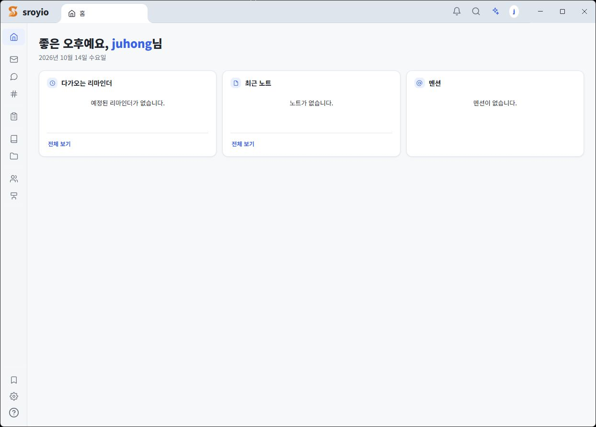
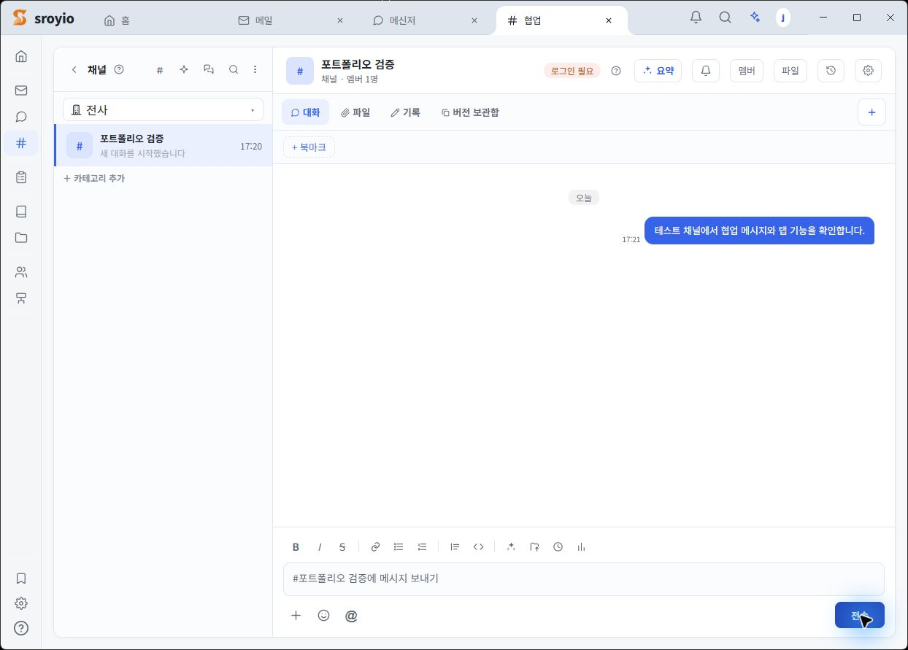
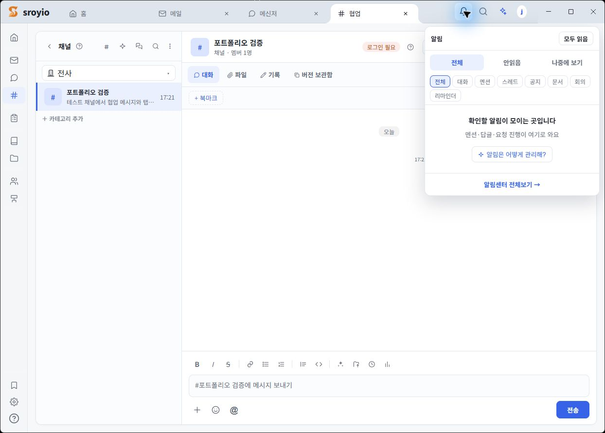

# Sroyio

**독립 실행형 기업용 협업 플랫폼**

Sroyio는 자체 사용자·세션과 PostgreSQL을 기반으로 업무 메시지, 채널 협업, 알림, 내부 메일을 처리하는 개인 프로젝트입니다. Electron Client와 Spring Boot Server를 분리했고, 백엔드 Case Study에는 문제와 설계 선택, 실제 구현, 검증 범위를 기록했습니다. 상세한 서술의 정본은 Notion의 `서주홍 Backend Portfolio`입니다.

[Source Code](https://github.com/development-juhong/sroyio) · [Architecture](docs/architecture/architecture.md) · [ERD](docs/erd/overview.md) · [Case Studies](#주요-case-study)

## 실제 실행 화면

분리된 로컬 PostgreSQL과 테스트 사용자로 실행한 화면입니다. 테스트 채널의 메시지는 실제 Client에서 전송·저장했습니다. 협업 화면의 `로그인 필요` 표시는 WebSocket 연결 성공의 근거가 아닙니다. 알림 패널은 테스트 데이터가 없는 상태입니다.

## 기술

Java 17 · Spring Boot 3.4.13 · Spring JDBC/JdbcTemplate · MyBatis · PostgreSQL · Flyway · WebSocket · Electron · JavaScript

## 주요 Case Study

- [Messenger](docs/case-study/01-messenger.md): 재전송 멱등성을 위한 DB Unique Constraint, Transaction, 참여자 Lock 순서
- [Collaboration](docs/case-study/02-collaboration.md): 연관 데이터 삭제 순서와 `row_version` 충돌 제어
- [Authentication & Permission](docs/case-study/03-authentication.md): refresh rotation, 세션 철회, `access_revision`, WebSocket frame gate
- [Notification](docs/case-study/04-notification.md): Outbox 선점과 lease, retry, UNKNOWN
- [Internal Mail](docs/case-study/05-internal-mail.md): 발송 Transaction, idempotency, BCC와 후속 알림 실패 경계

## 검증

원본 프로젝트에서 격리된 PostgreSQL **Integration Test 61개**와 별도 **Concurrency Regression Test 3개**(Messenger 2개, Collaboration 1개)가 PASS했습니다. Unit Test는 8개 Class·150개 Test가 PASS했습니다. 각 테스트가 확인한 경계와 남은 한계는 Case Study에 적었습니다. 운영 부하·성능과 실제 외부 Provider 동작은 검증하지 않았습니다.

공개 소스 스냅샷은 별도로 대표 Unit Test **87개**, PostgreSQL Integration Test **8개**, Backend·Client 빌드와 Standalone 기동을 확인했습니다. 원본 프로젝트의 검증 수치와 합산하지 않습니다.

## Source Code와 설계

**[Source Code](https://github.com/development-juhong/sroyio)** · [Case Study별 소스·테스트 위치](https://github.com/development-juhong/sroyio/blob/main/docs/source-map.md)

[Architecture](docs/architecture/architecture.md) · [ERD 개요](docs/erd/overview.md)

## AI Usage

AI Coding Agent를 코드 초안, 반복 작업, Test Case 제안, 코드 리뷰와 설계 검토에 사용했습니다. 결과는 Source·DB Schema·Test로 확인하며, 직접 설명하거나 수정할 수 없는 코드는 완료 구현으로 취급하지 않습니다.

## 선택적 연동

Groupware connector 등 외부 시스템은 기본 실행 경로와 분리된 선택적 연동입니다.
