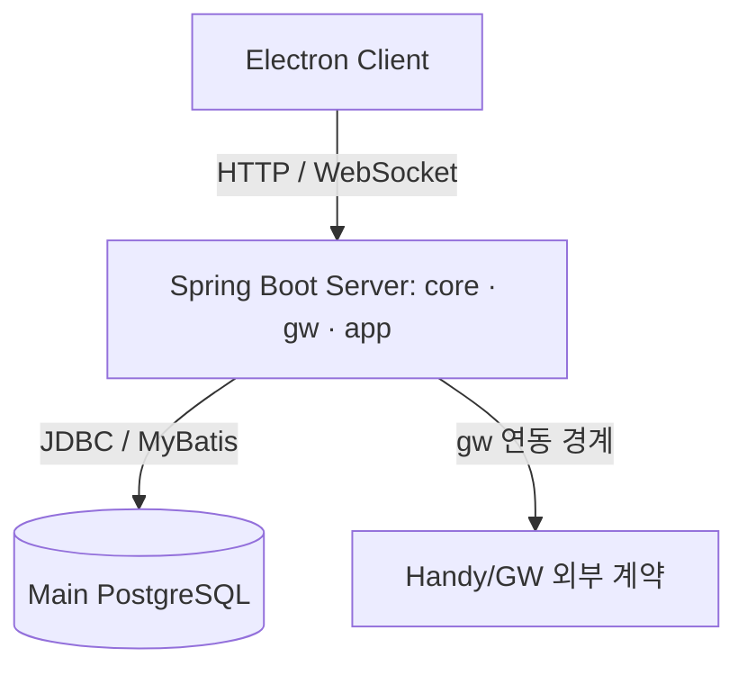

# Architecture

## 범위

이 문서는 현재 Sroyio의 주요 실행 경계와 다섯 Case Study의 상태 소유자를 요약합니다. Handy/GW와 외부 메일 제공자는 Sroyio가 소유하지 않는 연동 경계입니다.

Flyway는 Main PostgreSQL Schema Migration에 사용합니다.

| 경계 | 책임 | 확인한 근거 |
| --- | --- | --- |
| Client | 화면·사용자 입력과 Server 호출 | Electron Client, esbuild 설정 |
| Server `app` | Messenger, Collaboration, Auth, Notification, Internal Mail의 요청·도메인 처리 | 각 Case Study의 Service·Repository |
| Server `core` | 공통 신원·권한 및 기반 기능 | UserIdentityService 등 |
| Server `gw` | Handy/GW 연동 경계 | Server 모듈 구성 |
| Main PostgreSQL | 세션·메시지·협업·알림·내부 메일의 권위 있는 상태 | V1 및 후속 Flyway Migration |

## 데이터와 실패 경계

- **Messenger:** 메시지 저장, 미읽음 변경, 전송 fingerprint 기록을 Service Transaction으로 묶습니다. 성공 broadcast는 정상 반환 뒤 수행합니다. 중복 판정은 `ux_msg_message_client`가 마지막 경계입니다.
- **Collaboration:** Tab 삭제 시 Rule의 수명주기 잠금과 RUNNING 검사, Run 관련 행·Rule·Tab 삭제를 하나의 DB Transaction에 둡니다. Item은 Tab 삭제 시 FK cascade로 정리됩니다.
- **Authentication:** refresh token 회전에서는 저장된 hash를 조건부로 교체합니다. Bearer REST 요청과 새 WebSocket 연결은 세션 철회를 확인하고, 기존 WebSocket 입력 프레임은 사용자 상태와 `access_revision`을 제한된 cache 간격으로 확인합니다. 리소스 접근권은 각 Service가 별도로 판정합니다.
- **Notification:** 원본 수신함 상태와 전달 작업을 분리합니다. Worker는 `FOR UPDATE SKIP LOCKED`로 due 작업을 선점하고, 결과가 불확실하면 UNKNOWN으로 남깁니다.
- **Internal Mail:** 발송 ledger, 메시지, 수신자, Mailbox Entry, DB 첨부 참조, 필수 audit는 발송 DB Transaction에 둡니다. 알림 enqueue·전달과 물리 파일 lifecycle은 별도 실패 경계입니다.

## 검증 경계

Unit Test는 8개 Class·150개 Test, 격리된 PostgreSQL의 Integration Test는 10개 Class·61개 Test가 PASS했습니다. 별도 Concurrency Regression Test 3개(Messenger 2개, Collaboration 1개)가 PASS했으며, 61개 집계와 구분합니다. 각 검증의 보장 범위는 Case Study에 표시했습니다. 운영 부하·성능 및 실제 외부 Provider 동작은 검증 범위에 포함하지 않습니다.

## 근거 위치

`pom.xml`, `MessengerService`, `MessengerJdbcRepository`, `ChannelTabService`, `WorkflowService`, `ClientAuthSessionService`, `WsFrameGate`, `NotificationDeliveryWorker`, `InternalMailService`, Flyway `V1`, `V20`–`V23`, `V25`, `V36`, `V45`.
