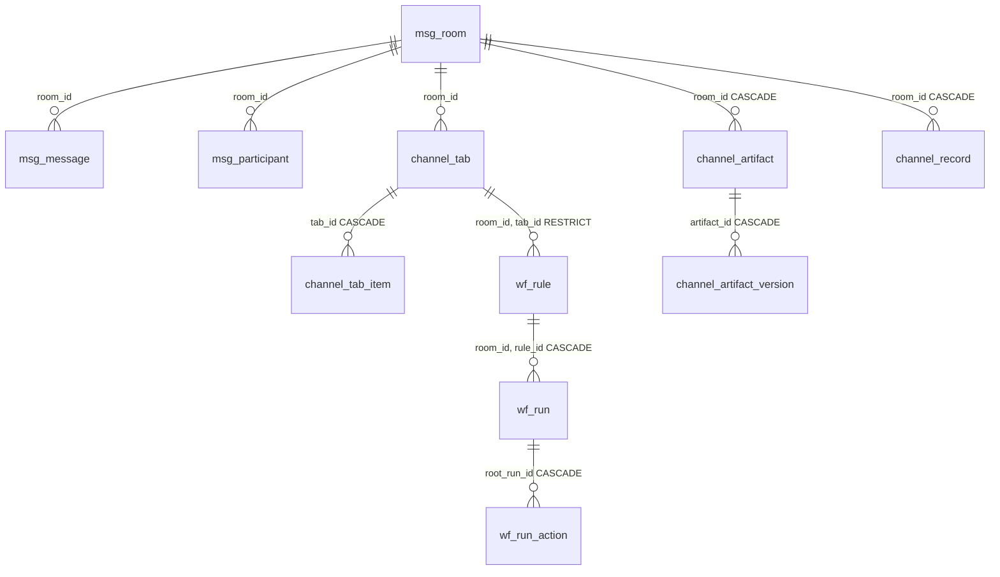
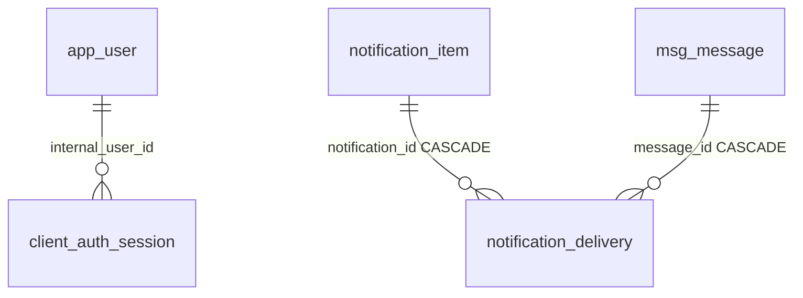
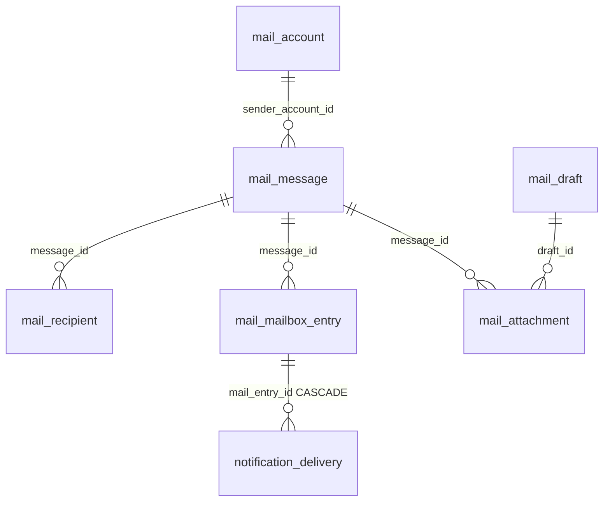

# ERD 개요

다섯 Case Study에 직접 관련된 테이블과 FK만 발췌했습니다. 전체 운영 Schema를 재현한 문서가 아닙니다. 선은 Migration에서 확인한 FK를 뜻하며, 사용자 ID 스냅샷이나 다형성 source 참조처럼 FK가 없는 연결은 선으로 그리지 않았습니다.

## Messenger · Collaboration

- `msg_message`: `(room_id, sender_id, client_msg_id)` 부분 Unique Index. `client_msg_id IS NOT NULL`인 전송의 중복 저장 경계입니다.
- `channel_tab`: `(room_id, tab_id)` Unique Constraint. `wf_rule`의 복합 FK 대상입니다.
- `channel_record`: `deleted_at`, `deleted_by`, `row_version`. 활성·삭제 유지관리용 부분 Index는 V20에 있습니다.
- `channel_artifact`: `status`, `deleted_at`, `deleted_by`, `row_version`. 삭제 항목 Index는 V21에 있습니다.

## Authentication · Notification

- `client_auth_session.refresh_token_hash`는 Unique Constraint를 가집니다. V25의 `app_user.access_revision`과 세션 발급 시 revision은 구분해 기록됩니다.
- `notification_item.dedupe_key`는 Unique입니다. `notification_state`는 사용자별 표시 상태 오버레이이며 `notification_delivery`의 전달 상태와 다릅니다.
- `notification_delivery`는 원본 유형별 참조 중 하나만 갖습니다. V23은 `mail_entry_id` FK를 더합니다. 알림·메시지·메일 Entry 각각에 수신자별 Unique 제약이 있습니다.
- V22의 due·lease 부분 Index는 Worker의 처리 대상 조회 패턴을 기준으로 정의돼 있습니다. V36은 전달 시도 이력을 더합니다.

## Internal Mail

- `mail_send_log`: `(user_id, idem_key)` Unique Constraint. 발송 재시도 판정에 사용합니다.
- `mail_mailbox_entry`: `(account_id, message_id, delivery_role)` Unique Constraint. 발신자의 Sent와 수신자의 Inbox 상태를 각 계정의 Entry로 보관합니다.
- `mail_recipient`: `(message_id, recipient_account_id)` PK와 `TO`·`CC`·`BCC` role. BCC 노출 여부는 Service의 조회 응답에서도 결정합니다.
- `mail_attachment.file_object_id`는 물리 파일에 대한 논리 참조이며 FK가 아닙니다. 물리 파일 lifecycle을 DB Transaction과 동일한 원자성으로 보지 않습니다.

## Migration 근거

`V1__sroyio_v1_baseline.sql`, `V10__meeting_calendar_notification_lifecycle.sql`, `V20__channel_record_logical_delete.sql`, `V21__channel_artifact_maintenance.sql`, `V22__notification_delivery_outbox.sql`, `V23__internal_mail_core.sql`, `V25__identity_access_revision.sql`, `V36__notification_delivery_attempt.sql`, `V45__msg_message_revision_send_hash.sql`.

PostgreSQL Integration Test는 이번 검증에서 NOT_RUN입니다. Index의 처리 시간 개선은 측정하지 않았습니다.
